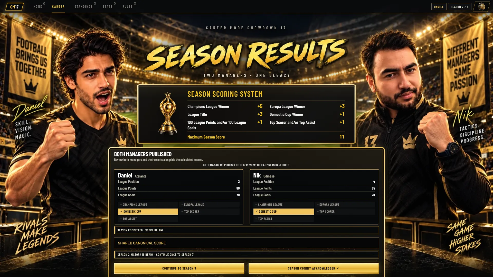
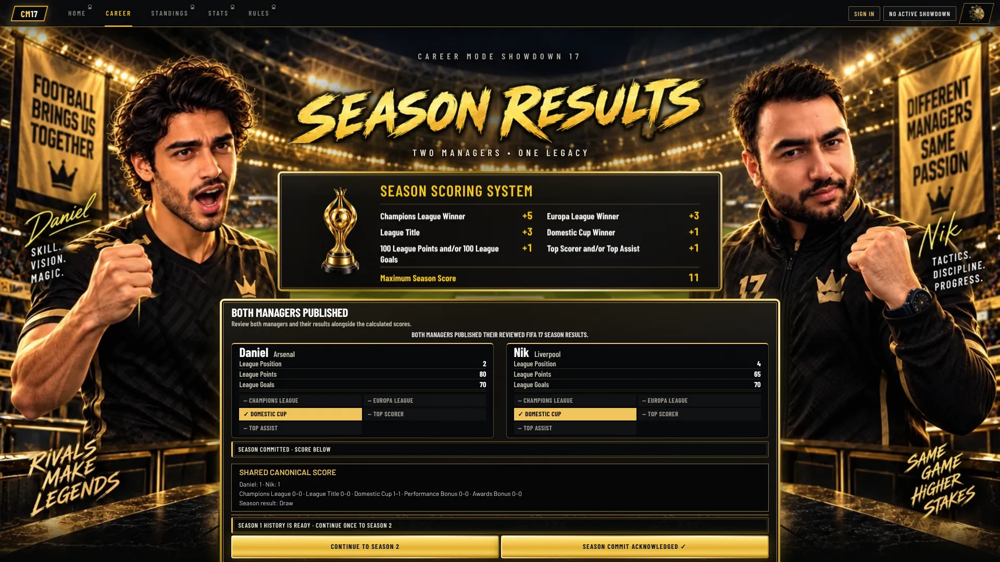
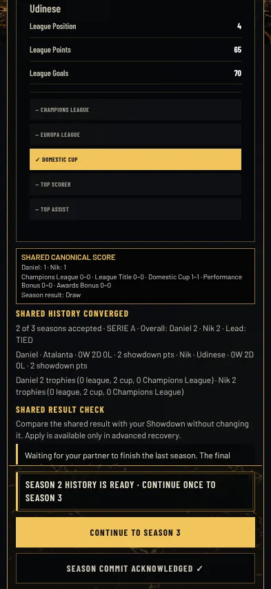
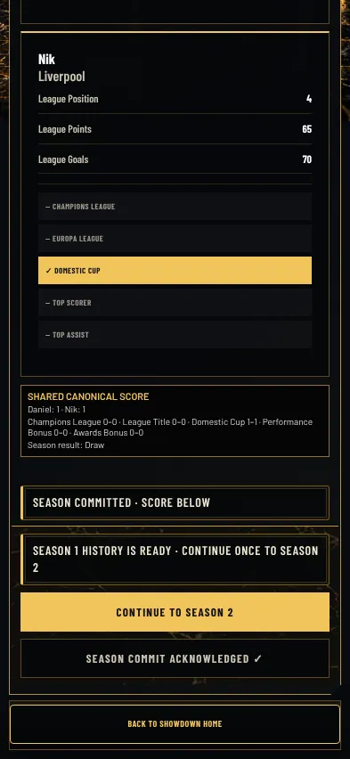
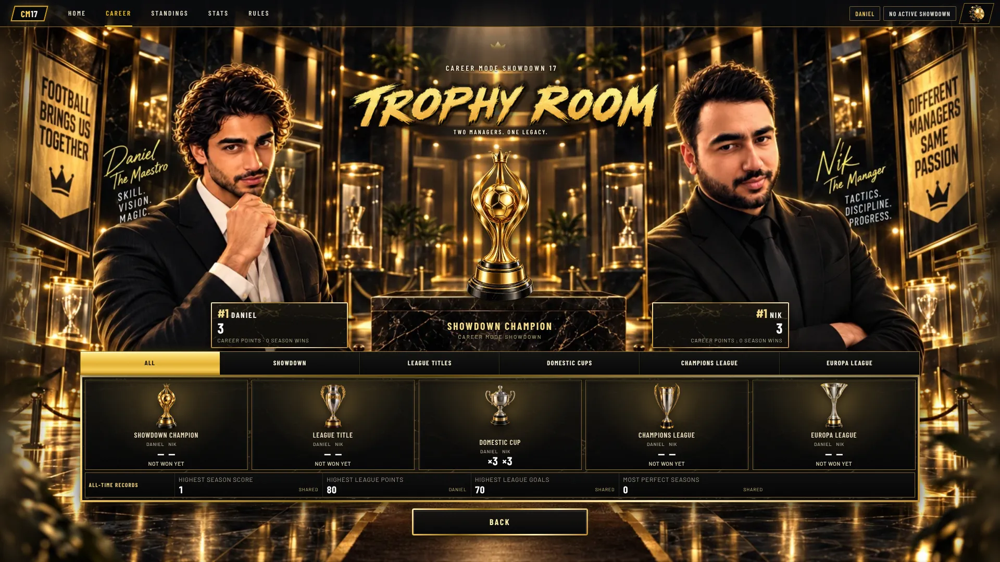
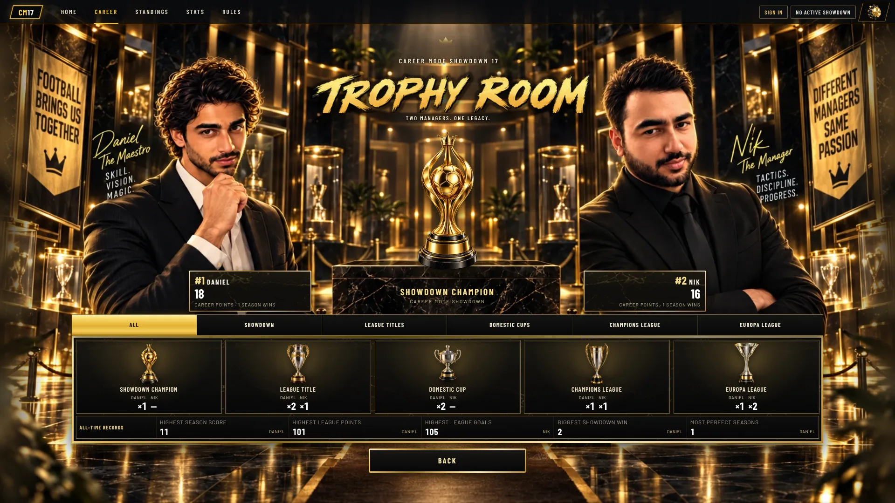
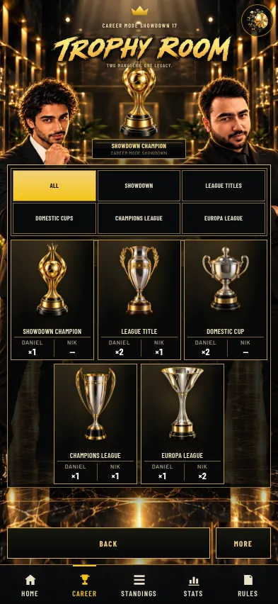

# r83 Job 18 gallery fixes

Before images are the unmodified PR #989 gallery captures at gameplay head `21e74be78eb4c6ba8332e08b70ab5cc3c0f5f902`.
After images come from `tests/browser/r83-gallery-layout-audit.cjs`: the real Results and Commit adapters and canonical scoring renderer, with read-only provider fixtures (1–1 Draw), plus the post-commit progression action/status markup; Trophy Room uses the existing read-only three-season career model. No Firebase requests or writes. These are layout evidence, not two-account production journey evidence. Phone Results is scrolled to its canonical score.

The docked Results actions painted over the canonical totals/result at Full HD. They now stay in flow when that score is shown; compact Full HD spacing keeps CONTINUE in the first view. Both desktop sizes also assert CONTINUE fits without scrolling. BACK explicitly shares MORE's gold label typography and centering.

The starting branch already had the local expiry timer and discovery-stop event. But stopping discovery skipped the redraw when JOIN had already detached the watcher. After a clock jump/suspended tab, that left JOIN stale until another refresh. The stop path now redraws CHECK STATUS even when already detached. The existing single local expiry timer remains in place. Contracts cover local expiry, discovery deadline, and a clock jump followed by stopping an already detached watch; none call refreshHome or add reads.

| View | Before | After |
| --- | --- | --- |
| Results desktop |  |  |
| Results phone |  |  |
| Trophy Room desktop |  |  |
| Trophy Room phone |  |  |

1366×768: [Results](images/season-results-1366x768-after.webp), [Trophy Room](images/trophy-room-1366x768-after.webp).
