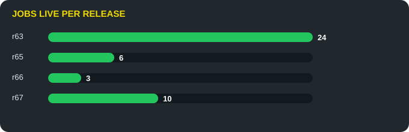
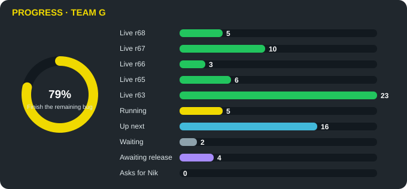

# Bug hunt board · Haiku G

**How to type.** Type just the number. GPT jobs in a new ChatGPT chat, Codex jobs in a new Codex task. One-time setup: [INSTRUCTIONS.md](queue/INSTRUCTIONS.md) and [CODEX_SETUP.md](queue/CODEX_SETUP.md). Tomorrow's order: [TOMORROW.md](queue/TOMORROW.md).





Updated Thu 29 Oct, 7:35 PM Boston time. Bug hunting only, no new features until further notice. The Team G and Team V Custom views and the board artifact show this same board. History of every job and bug report: [Board history](BOARD_ARCHIVE.md) · hand-offs between teams: [relay](RELAY.md).

🌐 **Live: 1.9.9-r85** (main `a8a5b37`, Thu 29 Oct 5:12 PM)

🩺 **All clear: every check has a machine.** · POS20 #304 6/16

## Jobs

### ▶️ Running now

**#1 · 1005** `G` Last season's score is skipped before the Final Winner  
`█████░░░░░` **50.0000 %**  
🟢 Team green · model not set · worker says done, no PR yet

**#2 · 1727** `G` Connect Players (start and join): sideways phone study, re-run (stage 4)  
`████░░░░░░` **40.0000 %**  
🟢 Team green · model not set · worker working, draft PR #773 · CI 6 of 7 passed · last move 419 h ago

**#3 · 1728** `G` Connect Players (start and join): upright tablet study, re-run (stage 4)  
`████░░░░░░` **40.0000 %**  
🟢 Team green · model not set · worker working, draft PR #774 · CI 6 of 7 passed · last move 419 h ago

**#4 · 1729** `G` Standings: sideways phone study, re-run (stage 4)  
`████░░░░░░` **40.0000 %**  
🟢 Team green · model not set · worker working, draft PR #779 · CI 6 of 7 passed · last move 419 h ago

**#5 · 1730** `G` Trophy Room: sideways phone study, re-run (stage 4)  
`████░░░░░░` **40.0000 %**  
🟢 Team green · model not set · worker working, draft PR #775 · CI 6 of 7 passed · last move 419 h ago

**#6 · 1731** `G` Rule Book: sideways phone study, re-run (stage 4)  
`████░░░░░░` **40.0000 %**  
🟢 Team green · model not set · worker working, draft PR #778 · CI 6 of 7 passed · last move 419 h ago

**#7 · 1732** `G` Legacy: upright tablet study, re-run (stage 4)  
`████░░░░░░` **40.0000 %**  
🟢 Team green · model not set · worker working, draft PR #780 · CI 6 of 7 passed · last move 419 h ago

**#8 · 1802** `G` CE2PG harness on the r76 base, plus baseline runs  
`████░░░░░░` **40.0000 %**  
⚪ Team white · model not set · worker working, draft PR #836 · CI 7 of 8 passed · last move 389 h ago

**#9 · 1816** `G` Integration branch of all r76 PRs, plus full checks  
`████░░░░░░` **40.0000 %**  
⚪ Team white · model not set · worker working, draft PR #854 · CI 7 of 8 passed · last move 346 h ago

**#10 · 1819** `G` r76 gallery: every screen rendered from the integration branch, desktop and phone  
`████░░░░░░` **40.0000 %**  
⚪ Team white · model not set · worker working, draft PR #855 · CI 7 of 8 passed · last move 343 h ago

**#11 · 1824** `G` Measure Firestore reads and writes per season, and predict seasons per day (emulator only)  
`████░░░░░░` **40.0000 %**  
⚪ Team white · model not set · worker working, draft PR #851 · CI 7 of 8 passed · last move 358 h ago

**#12 · 1825** `G` Exact Rules lookup cost per season, and a ranked plan to cut it (emulator only, report only)  
`████░░░░░░` **40.0000 %**  
⚪ Team white · model not set · worker working, draft PR #853 · CI 7 of 8 passed · last move 355 h ago

**#13 · 1830** `G` r76 integration round 2: every r76 fix together, then the meter and CE2PG on the combined head  
`████░░░░░░` **40.0000 %**  
⚪ Team white · model not set · worker working, draft PR #869

**#14 · 1836** `G` CE2PG release run A: 1 and 3 seasons, 3 runs each, plus a draw  
`████░░░░░░` **40.0000 %**  
⚪ Team white · model not set · worker working, draft PR #872 · CI 7 of 8 passed · last move 316 h ago

**#15 · 1837** `G` CE2PG release run B: 5 seasons, 3 runs  
`████░░░░░░` **40.0000 %**  
⚪ Team white · model not set · worker working, draft PR #875 · CI 7 of 8 passed · last move 314 h ago

**#16 · 1838** `G` CE2PG release run C: 10 seasons, 3 runs  
`████░░░░░░` **40.0000 %**  
⚪ Team white · model not set · worker working, draft PR #876 · CI 7 of 8 passed · last move 313 h ago

**#17 · 1839** `G` r76 gallery refresh: every screen from the final workbench, desktop and phone  
`████░░░░░░` **40.0000 %**  
⚪ Team white · model not set · worker working, draft PR #877 · CI 7 of 8 passed · last move 313 h ago

### 👉 Next for you, in this order

**#1 · 1581** `G` Showdown Gate: split the slowest lane and cache downloads  
`░░░░░░░░░░` **0.0000 %**  
⚪ Team white · **Codex default coding model** · High effort · Codex cloud, this repo

Paste this:

```text
Career Mode Showdown, job 1581. First run: git fetch origin factory/gameplay-v1
Then read: git show FETCH_HEAD:project-documents/gameplay-factory/jobs/JOB-1581.md
Do exactly what that file says. If the file does not exist, stop and tell me. Never push to main and never merge. Open any pull request as a draft; if you cannot choose the base branch, write RETARGET TO gameplay/bug-list-1 on the first line of the PR body.
```

**#2 · 1589** `G` Browser test that catches the old-design flash on screen changes (tests only)  
`░░░░░░░░░░` **0.0000 %**  
⚪ Team white · **Codex default coding model** · Medium effort · Codex cloud, this repo

Paste this:

```text
Career Mode Showdown, job 1589. First run: git fetch origin factory/gameplay-v1
Then read: git show FETCH_HEAD:project-documents/gameplay-factory/jobs/JOB-1589.md
Do exactly what that file says. If the file does not exist, stop and tell me. Never push to main and never merge. Open any pull request as a draft; if you cannot choose the base branch, write RETARGET TO gameplay/bug-list-1 on the first line of the PR body.
```

**#3 · 1590** `G` Audit: which screens have no Team V look yet (read only)  
`░░░░░░░░░░` **0.0000 %**  
🔵 Team blue · **GPT-6 Sol** · High effort · ChatGPT project "Career Mode Showdown", normal chat

Paste this:

```text
1590
```

**#4 · 1592** `G` Wire Team V study 1110: Connect Players phone  
`░░░░░░░░░░` **0.0000 %**  
🟢 Team green · **GPT Sol 6.1** · High effort · ChatGPT Work mode (Sol 6.1), type one number at a time, in order

Paste this:

```text
1592
```

**#5 · 1593** `G` Wire Team V study 1372: Rivalry Statistics phone  
`░░░░░░░░░░` **0.0000 %**  
🟢 Team green · **GPT Sol 6.1** · High effort · ChatGPT Work mode (Sol 6.1), type one number at a time, in order

Paste this:

```text
1593
```

**#6 · 1594** `G` Wire Team V study 1169: Club Assignment (redo train)  
`░░░░░░░░░░` **0.0000 %**  
🟢 Team green · **GPT Sol 6.1** · High effort · ChatGPT Work mode (Sol 6.1), type one number at a time, in order

Paste this:

```text
1594
```

**#7 · 1595** `G` Wire Team V study 1171: Club Assignment (redo train)  
`░░░░░░░░░░` **0.0000 %**  
🟢 Team green · **GPT Sol 6.1** · High effort · ChatGPT Work mode (Sol 6.1), type one number at a time, in order

Paste this:

```text
1595
```

**#8 · 1596** `G` Wire Team V study 1172: Club Assignment (redo train)  
`░░░░░░░░░░` **0.0000 %**  
🟢 Team green · **GPT Sol 6.1** · High effort · ChatGPT Work mode (Sol 6.1), type one number at a time, in order

Paste this:

```text
1596
```

**#9 · 1600** `G` Wire Team V study 1374: Rivalry Statistics sideways  
`░░░░░░░░░░` **0.0000 %**  
🟢 Team green · **GPT Sol 6.1** · High effort · ChatGPT Work mode (Sol 6.1), type one number at a time, in order

Paste this:

```text
1600
```

**#10 · 1601** `G` Wire Team V study 1375: Rivalry Statistics tablet  
`░░░░░░░░░░` **0.0000 %**  
🟢 Team green · **GPT Sol 6.1** · High effort · ChatGPT Work mode (Sol 6.1), type one number at a time, in order

Paste this:

```text
1601
```

**#11 · 1602** `G` Wire Team V study 1402: Career Statistics  
`░░░░░░░░░░` **0.0000 %**  
🟢 Team green · **GPT Sol 6.1** · High effort · ChatGPT Work mode (Sol 6.1), type one number at a time, in order

Paste this:

```text
1602
```

**#12 · 1603** `G` Wire Team V study 1403: Career Statistics  
`░░░░░░░░░░` **0.0000 %**  
🟢 Team green · **GPT Sol 6.1** · High effort · ChatGPT Work mode (Sol 6.1), type one number at a time, in order

Paste this:

```text
1603
```

**#13 · 1604** `G` Wire Team V study 1404: Career Statistics  
`░░░░░░░░░░` **0.0000 %**  
🟢 Team green · **GPT Sol 6.1** · High effort · ChatGPT Work mode (Sol 6.1), type one number at a time, in order

Paste this:

```text
1604
```

**#14 · 1605** `G` Trophy Room picked-tab: 1536 art, lazy, toward PHONE_TROPHY_ROOM_SINGLE  
`░░░░░░░░░░` **0.0000 %**  
🟢 Team green · **GPT Sol 6.1** · High effort · ChatGPT Work mode (Sol 6.1), type one number at a time, in order

Paste this:

```text
1605
```

**#15 · 1606** `G` Fix (verify first) audit 88: failed refresh shown as publish failure (Season Results)  
`░░░░░░░░░░` **0.0000 %**  
🔵 Team blue · **GPT-6 Sol** · High effort · ChatGPT project "Career Mode Showdown", normal chat

Paste this:

```text
1606
```

**#16 · 1607** `G` Fix (verify first) audit 92: failed refresh shown as commit failure (Season Commit)  
`░░░░░░░░░░` **0.0000 %**  
🔵 Team blue · **GPT-6 Sol** · High effort · ChatGPT project "Career Mode Showdown", normal chat

Paste this:

```text
1607
```

**#17 · 1608** `G` Fix (verify first) audit 116: background read disables Shared Setup buttons  
`░░░░░░░░░░` **0.0000 %**  
🔵 Team blue · **GPT-6 Sol** · High effort · ChatGPT project "Career Mode Showdown", normal chat

Paste this:

```text
1608
```

**#18 · 1609** `G` Transfer phone study D faithful to PHONE_TRANSFER  
`░░░░░░░░░░` **0.0000 %**  
🔵 Team blue · **GPT-6 Sol** · High effort · ChatGPT project "Career Mode Showdown", normal chat

Paste this:

```text
1609
```

**#19 · 1612** `G` Wire Team V study 1284: Final Winner  
`░░░░░░░░░░` **0.0000 %**  
🟢 Team green · **GPT Sol 6.1** · High effort · ChatGPT Work mode (Sol 6.1), type one number at a time, in order

Paste this:

```text
1612
```

**#20 · 1613** `G` Wire Team V study 1287: Final Winner  
`░░░░░░░░░░` **0.0000 %**  
🟢 Team green · **GPT Sol 6.1** · High effort · ChatGPT Work mode (Sol 6.1), type one number at a time, in order

Paste this:

```text
1613
```

**#21 · 1614** `G` Wire Team V study 1288: Final Winner  
`░░░░░░░░░░` **0.0000 %**  
🟢 Team green · **GPT Sol 6.1** · High effort · ChatGPT Work mode (Sol 6.1), type one number at a time, in order

Paste this:

```text
1614
```

**#22 · 1615** `G` Wire Team V study 1313: Legacy  
`░░░░░░░░░░` **0.0000 %**  
🟢 Team green · **GPT Sol 6.1** · High effort · ChatGPT Work mode (Sol 6.1), type one number at a time, in order

Paste this:

```text
1615
```

**#23 · 1616** `G` Wire Team V study 1316: Legacy  
`░░░░░░░░░░` **0.0000 %**  
🟢 Team green · **GPT Sol 6.1** · High effort · ChatGPT Work mode (Sol 6.1), type one number at a time, in order

Paste this:

```text
1616
```

**#24 · 1617** `G` Wire Team V study 1342: Trophy Room  
`░░░░░░░░░░` **0.0000 %**  
🟢 Team green · **GPT Sol 6.1** · High effort · ChatGPT Work mode (Sol 6.1), type one number at a time, in order

Paste this:

```text
1617
```

**#25 · 1618** `G` Wire Team V study 1346: Trophy Room  
`░░░░░░░░░░` **0.0000 %**  
🟢 Team green · **GPT Sol 6.1** · High effort · ChatGPT Work mode (Sol 6.1), type one number at a time, in order

Paste this:

```text
1618
```

**#26 · 1619** `G` Wire Team V study 1460: Settings  
`░░░░░░░░░░` **0.0000 %**  
🟢 Team green · **GPT Sol 6.1** · High effort · ChatGPT Work mode (Sol 6.1), type one number at a time, in order

Paste this:

```text
1619
```

**#27 · 1620** `G` Wire Team V study 1461: Settings  
`░░░░░░░░░░` **0.0000 %**  
🟢 Team green · **GPT Sol 6.1** · High effort · ChatGPT Work mode (Sol 6.1), type one number at a time, in order

Paste this:

```text
1620
```

**#28 · 1621** `G` Wire Team V study 1462: Settings  
`░░░░░░░░░░` **0.0000 %**  
🟢 Team green · **GPT Sol 6.1** · High effort · ChatGPT Work mode (Sol 6.1), type one number at a time, in order

Paste this:

```text
1621
```

**#29 · 1622** `G` Study re-run (1139): Select League phone mockup, version A (faithful)  
`░░░░░░░░░░` **0.0000 %**  
🟢 Team green · **GPT Sol 6.1** · High effort · ChatGPT Work mode (Sol 6.1), type one number at a time, in order

Paste this:

```text
1622
```

**#30 · 1623** `G` Study re-run (1140): Select League phone mockup, version B (bold hierarchy)  
`░░░░░░░░░░` **0.0000 %**  
🟢 Team green · **GPT Sol 6.1** · High effort · ChatGPT Work mode (Sol 6.1), type one number at a time, in order

Paste this:

```text
1623
```

**#31 · 1624** `G` Study re-run (1141): Select League phone mockup, version C (compact)  
`░░░░░░░░░░` **0.0000 %**  
🟢 Team green · **GPT Sol 6.1** · High effort · ChatGPT Work mode (Sol 6.1), type one number at a time, in order

Paste this:

```text
1624
```

**#32 · 1625** `G` Study re-run (1142): Select League sideways phone study  
`░░░░░░░░░░` **0.0000 %**  
🟢 Team green · **GPT Sol 6.1** · High effort · ChatGPT Work mode (Sol 6.1), type one number at a time, in order

Paste this:

```text
1625
```

**#33 · 1626** `G` Study re-run (1143): Select League upright tablet study  
`░░░░░░░░░░` **0.0000 %**  
🟢 Team green · **GPT Sol 6.1** · High effort · ChatGPT Work mode (Sol 6.1), type one number at a time, in order

Paste this:

```text
1626
```

**#34 · 1627** `G` Study re-run (1082): Home phone mockup, version B (bold hierarchy)  
`░░░░░░░░░░` **0.0000 %**  
🟢 Team green · **GPT Sol 6.1** · High effort · ChatGPT Work mode (Sol 6.1), type one number at a time, in order

Paste this:

```text
1627
```

**#35 · 1628** `G` Study re-run (1083): Home phone mockup, version C (compact)  
`░░░░░░░░░░` **0.0000 %**  
🟢 Team green · **GPT Sol 6.1** · High effort · ChatGPT Work mode (Sol 6.1), type one number at a time, in order

Paste this:

```text
1628
```

**#36 · 1629** `G` Study re-run (1084): Home sideways phone study  
`░░░░░░░░░░` **0.0000 %**  
🟢 Team green · **GPT Sol 6.1** · High effort · ChatGPT Work mode (Sol 6.1), type one number at a time, in order

Paste this:

```text
1629
```

**#37 · 1630** `G` Wire Team V study 1622: Select League (phone)  
`░░░░░░░░░░` **0.0000 %**  
🟢 Team green · **GPT Sol 6.1** · High effort · ChatGPT Work mode (Sol 6.1), type one number at a time, in order

Paste this:

```text
1630
```

**#38 · 1631** `G` Wire Team V study 1625: Select League (sideways)  
`░░░░░░░░░░` **0.0000 %**  
🟢 Team green · **GPT Sol 6.1** · High effort · ChatGPT Work mode (Sol 6.1), type one number at a time, in order

Paste this:

```text
1631
```

**#39 · 1632** `G` Wire Team V study 1626: Select League (tablet)  
`░░░░░░░░░░` **0.0000 %**  
🟢 Team green · **GPT Sol 6.1** · High effort · ChatGPT Work mode (Sol 6.1), type one number at a time, in order

Paste this:

```text
1632
```

**#40 · 1591** `G` Home soundtrack: swap to Nik's Audius top 10  
`░░░░░░░░░░` **0.0000 %**  
🟣 Team purple · model not set · Claude lane: Opus Medium for the change, Sonnet for the live listen and browser check: type 'Job 1591'

Type this in Claude lane: Opus Medium for the change, Sonnet for the live listen and browser check:

```text
Job 1591
```

**#41 · 1635** `G` Smooth screen transitions, and nothing from the old game ever flashes  
`░░░░░░░░░░` **0.0000 %**  
worker not set · model not set · Nik, in a claude.ai/code **cloud session** on repo `nikahanghojjati-oss/fifa17-career-showdown2`: type 'Job 1635'

Type this in Nik, in a claude.ai/code **cloud session** on repo `nikahanghojjati-oss/fifa17-career-showdown2`:

```text
Job 1635
```

**#42 · 1647** `G` Loading screen: wire the approved PHONE_LOADING and NEXT_LOADING pictures  
`░░░░░░░░░░` **0.0000 %**  
⚪ Team white · model not set · Codex cloud: type 'Job 1647'

Type this in Codex cloud:

```text
Job 1647
```

**#43 · 1648** `G` Old CSS: which old sheets and selectors are still live (report only)  
`░░░░░░░░░░` **0.0000 %**  
⚪ Team white · model not set · Codex cloud: type 'Job 1648'

Type this in Codex cloud:

```text
Job 1648
```

**#44 · 1649** `G` Old CSS: archive the dead sheets (after the r71 release)  
`░░░░░░░░░░` **0.0000 %**  
🟤 Team brown · model not set · Claude lane: Sonnet, medium: type 'Job 1649'

Type this in Claude lane: Sonnet, medium:

```text
Job 1649
```

**#45 · 1650** `G` Service worker: can an old page ever mix with new files? (report only)  
`░░░░░░░░░░` **0.0000 %**  
🔵 Team blue · model not set · GPT chat: type 'Job 1650'

New chat inside the ChatGPT project Career Mode Showdown (Stay in Chat), type:

```text
Job 1650
```

**#46 · 1651** `G` Flash guard: cover Season Results, Final Winner and Rivalry, and time tap feedback  
`░░░░░░░░░░` **0.0000 %**  
⚪ Team white · model not set · Codex cloud: type 'Job 1651'

Type this in Codex cloud:

```text
Job 1651
```

**#47 · 1652** `G` Settings › Motion: add a FULL MOTION choice  
`░░░░░░░░░░` **0.0000 %**  
🔵 Team blue · model not set · GPT chat: type 'Job 1652'

New chat inside the ChatGPT project Career Mode Showdown (Stay in Chat), type:

```text
Job 1652
```

**#48 · 1653** `G` Reduced motion: stop the remaining Club script fades  
`░░░░░░░░░░` **0.0000 %**  
⚪ Team white · model not set · Codex cloud: type 'Job 1653'

Type this in Codex cloud:

```text
Job 1653
```

**#49 · 1695** `G` Home: one Work mode job for the whole screen  
`░░░░░░░░░░` **0.0000 %**  
🟢 Team green · model not set · GPT Work mode: type 'Job 1695'

New chat inside the ChatGPT project Career Mode Showdown, switch to Work mode (cheaper model), type:

```text
Job 1695
```

**#50 · 1696** `G` Connect Players (Start and Join): one Work mode job for the whole screen  
`░░░░░░░░░░` **0.0000 %**  
🟢 Team green · model not set · GPT Work mode: type 'Job 1696'

New chat inside the ChatGPT project Career Mode Showdown, switch to Work mode (cheaper model), type:

```text
Job 1696
```

**#51 · 1697** `G` Select League: one Work mode job for the whole screen  
`░░░░░░░░░░` **0.0000 %**  
🟢 Team green · model not set · GPT Work mode: type 'Job 1697'

New chat inside the ChatGPT project Career Mode Showdown, switch to Work mode (cheaper model), type:

```text
Job 1697
```

**#52 · 1698** `G` Club packs: one Work mode job for the whole screen  
`░░░░░░░░░░` **0.0000 %**  
🟢 Team green · model not set · GPT Work mode: type 'Job 1698'

New chat inside the ChatGPT project Career Mode Showdown, switch to Work mode (cheaper model), type:

```text
Job 1698
```

**#53 · 1699** `G` Transfer challenge and Signing Entry: one Work mode job for the whole screen  
`░░░░░░░░░░` **0.0000 %**  
🟢 Team green · model not set · GPT Work mode: type 'Job 1699'

New chat inside the ChatGPT project Career Mode Showdown, switch to Work mode (cheaper model), type:

```text
Job 1699
```

**#54 · 1700** `G` Season Results: one Work mode job for the whole screen  
`░░░░░░░░░░` **0.0000 %**  
🟢 Team green · model not set · GPT Work mode: type 'Job 1700'

New chat inside the ChatGPT project Career Mode Showdown, switch to Work mode (cheaper model), type:

```text
Job 1700
```

**#55 · 1701** `G` Standings: one Work mode job for the whole screen  
`░░░░░░░░░░` **0.0000 %**  
🟢 Team green · model not set · GPT Work mode: type 'Job 1701'

New chat inside the ChatGPT project Career Mode Showdown, switch to Work mode (cheaper model), type:

```text
Job 1701
```

**#56 · 1702** `G` Final Winner (Showdown Champion): one Work mode job for the whole screen  
`░░░░░░░░░░` **0.0000 %**  
🟢 Team green · model not set · GPT Work mode: type 'Job 1702'

New chat inside the ChatGPT project Career Mode Showdown, switch to Work mode (cheaper model), type:

```text
Job 1702
```

**#57 · 1703** `G` Rivalry Statistics: one Work mode job for the whole screen  
`░░░░░░░░░░` **0.0000 %**  
🟢 Team green · model not set · GPT Work mode: type 'Job 1703'

New chat inside the ChatGPT project Career Mode Showdown, switch to Work mode (cheaper model), type:

```text
Job 1703
```

**#58 · 1704** `G` Legacy: one Work mode job for the whole screen  
`░░░░░░░░░░` **0.0000 %**  
🟢 Team green · model not set · GPT Work mode: type 'Job 1704'

New chat inside the ChatGPT project Career Mode Showdown, switch to Work mode (cheaper model), type:

```text
Job 1704
```

**#59 · 1705** `G` Trophy Room: one Work mode job for the whole screen  
`░░░░░░░░░░` **0.0000 %**  
🟢 Team green · model not set · GPT Work mode: type 'Job 1705'

New chat inside the ChatGPT project Career Mode Showdown, switch to Work mode (cheaper model), type:

```text
Job 1705
```

**#60 · 1706** `G` Career Statistics: one Work mode job for the whole screen  
`░░░░░░░░░░` **0.0000 %**  
🟢 Team green · model not set · GPT Work mode: type 'Job 1706'

New chat inside the ChatGPT project Career Mode Showdown, switch to Work mode (cheaper model), type:

```text
Job 1706
```

**#61 · 1707** `G` Rule Book: one Work mode job for the whole screen  
`░░░░░░░░░░` **0.0000 %**  
🟢 Team green · model not set · GPT Work mode: type 'Job 1707'

New chat inside the ChatGPT project Career Mode Showdown, switch to Work mode (cheaper model), type:

```text
Job 1707
```

**#62 · 1708** `G` Settings: one Work mode job for the whole screen  
`░░░░░░░░░░` **0.0000 %**  
🟢 Team green · model not set · GPT Work mode: type 'Job 1708'

New chat inside the ChatGPT project Career Mode Showdown, switch to Work mode (cheaper model), type:

```text
Job 1708
```

**#63 · 1709** `G` Home: CHAT job (picture-free fixes at every size)  
`░░░░░░░░░░` **0.0000 %**  
🔵 Team blue · model not set · GPT chat: type 'Job 1709'

New chat inside the ChatGPT project Career Mode Showdown (Stay in Chat), type:

```text
Job 1709
```

**#64 · 1710** `G` Connect Players: CHAT job (picture-free fixes at every size)  
`░░░░░░░░░░` **0.0000 %**  
🔵 Team blue · model not set · GPT chat: type 'Job 1710'

New chat inside the ChatGPT project Career Mode Showdown (Stay in Chat), type:

```text
Job 1710
```

**#65 · 1711** `G` League: CHAT job (picture-free fixes at every size)  
`░░░░░░░░░░` **0.0000 %**  
🔵 Team blue · model not set · GPT chat: type 'Job 1711'

New chat inside the ChatGPT project Career Mode Showdown (Stay in Chat), type:

```text
Job 1711
```

**#66 · 1712** `G` Club: CHAT job (picture-free fixes at every size)  
`░░░░░░░░░░` **0.0000 %**  
🔵 Team blue · model not set · GPT chat: type 'Job 1712'

New chat inside the ChatGPT project Career Mode Showdown (Stay in Chat), type:

```text
Job 1712
```

**#67 · 1713** `G` Transfer: CHAT job (picture-free fixes at every size)  
`░░░░░░░░░░` **0.0000 %**  
🔵 Team blue · model not set · GPT chat: type 'Job 1713'

New chat inside the ChatGPT project Career Mode Showdown (Stay in Chat), type:

```text
Job 1713
```

**#68 · 1714** `G` Season Results: CHAT job (picture-free fixes at every size)  
`░░░░░░░░░░` **0.0000 %**  
🔵 Team blue · model not set · GPT chat: type 'Job 1714'

New chat inside the ChatGPT project Career Mode Showdown (Stay in Chat), type:

```text
Job 1714
```

**#69 · 1715** `G` Standings: CHAT job (picture-free fixes at every size)  
`░░░░░░░░░░` **0.0000 %**  
🔵 Team blue · model not set · GPT chat: type 'Job 1715'

New chat inside the ChatGPT project Career Mode Showdown (Stay in Chat), type:

```text
Job 1715
```

**#70 · 1716** `G` Final Winner: CHAT job (picture-free fixes at every size)  
`░░░░░░░░░░` **0.0000 %**  
🔵 Team blue · model not set · GPT chat: type 'Job 1716'

New chat inside the ChatGPT project Career Mode Showdown (Stay in Chat), type:

```text
Job 1716
```

**#71 · 1717** `G` Rivalry Statistics: CHAT job (picture-free fixes at every size)  
`░░░░░░░░░░` **0.0000 %**  
🔵 Team blue · model not set · GPT chat: type 'Job 1717'

New chat inside the ChatGPT project Career Mode Showdown (Stay in Chat), type:

```text
Job 1717
```

**#72 · 1718** `G` Legacy: CHAT job (picture-free fixes at every size)  
`░░░░░░░░░░` **0.0000 %**  
🔵 Team blue · model not set · GPT chat: type 'Job 1718'

New chat inside the ChatGPT project Career Mode Showdown (Stay in Chat), type:

```text
Job 1718
```

**#73 · 1719** `G` Trophy Room: CHAT job (picture-free fixes at every size)  
`░░░░░░░░░░` **0.0000 %**  
🔵 Team blue · model not set · GPT chat: type 'Job 1719'

New chat inside the ChatGPT project Career Mode Showdown (Stay in Chat), type:

```text
Job 1719
```

**#74 · 1720** `G` Career Statistics: CHAT job (picture-free fixes at every size)  
`░░░░░░░░░░` **0.0000 %**  
🔵 Team blue · model not set · GPT chat: type 'Job 1720'

New chat inside the ChatGPT project Career Mode Showdown (Stay in Chat), type:

```text
Job 1720
```

**#75 · 1721** `G` Rule Book: CHAT job (picture-free fixes at every size)  
`░░░░░░░░░░` **0.0000 %**  
🔵 Team blue · model not set · GPT chat: type 'Job 1721'

New chat inside the ChatGPT project Career Mode Showdown (Stay in Chat), type:

```text
Job 1721
```

**#76 · 1722** `G` Settings: CHAT job (picture-free fixes at every size)  
`░░░░░░░░░░` **0.0000 %**  
🔵 Team blue · model not set · GPT chat: type 'Job 1722'

New chat inside the ChatGPT project Career Mode Showdown (Stay in Chat), type:

```text
Job 1722
```

**#77 · 1723** `G` QoL 2: Career Start errors in plain English  
`░░░░░░░░░░` **0.0000 %**  
🔵 Team blue · model not set · GPT chat: type 'Job 1723'

New chat inside the ChatGPT project Career Mode Showdown (Stay in Chat), type:

```text
Job 1723
```

**#78 · 1724** `G` QoL 4: a finished Showdown stops saying LEADS  
`░░░░░░░░░░` **0.0000 %**  
🔵 Team blue · model not set · GPT chat: type 'Job 1724'

New chat inside the ChatGPT project Career Mode Showdown (Stay in Chat), type:

```text
Job 1724
```

**#79 · 1725** `G` QoL 5: a photo that failed once loads on the next try  
`░░░░░░░░░░` **0.0000 %**  
🔵 Team blue · model not set · GPT chat: type 'Job 1725'

New chat inside the ChatGPT project Career Mode Showdown (Stay in Chat), type:

```text
Job 1725
```

**#80 · 1726** `G` QoL 8: a failed load cannot double up taps on retry  
`░░░░░░░░░░` **0.0000 %**  
🔵 Team blue · model not set · GPT chat: type 'Job 1726'

New chat inside the ChatGPT project Career Mode Showdown (Stay in Chat), type:

```text
Job 1726
```

**#81 · 1733** `G` Audit and fix js/seasonEngine.js (first half (lines 1 to 480))  
`░░░░░░░░░░` **0.0000 %**  
🔵 Team blue · model not set · GPT chat: type 'Job 1733'

New chat inside the ChatGPT project Career Mode Showdown (Stay in Chat), type:

```text
Job 1733
```

**#82 · 1734** `G` Audit and fix js/seasonEngine.js (second half (lines 480 to the end))  
`░░░░░░░░░░` **0.0000 %**  
🔵 Team blue · model not set · GPT chat: type 'Job 1734'

New chat inside the ChatGPT project Career Mode Showdown (Stay in Chat), type:

```text
Job 1734
```

**#83 · 1735** `G` Audit and fix js/transferChallenge.js (first half (lines 1 to 520))  
`░░░░░░░░░░` **0.0000 %**  
🔵 Team blue · model not set · GPT chat: type 'Job 1735'

New chat inside the ChatGPT project Career Mode Showdown (Stay in Chat), type:

```text
Job 1735
```

**#84 · 1736** `G` Audit and fix js/transferChallenge.js (second half (lines 520 to the end))  
`░░░░░░░░░░` **0.0000 %**  
🔵 Team blue · model not set · GPT chat: type 'Job 1736'

New chat inside the ChatGPT project Career Mode Showdown (Stay in Chat), type:

```text
Job 1736
```

**#85 · 1737** `G` Audit and fix js/statistics.js (whole file)  
`░░░░░░░░░░` **0.0000 %**  
🔵 Team blue · model not set · GPT chat: type 'Job 1737'

New chat inside the ChatGPT project Career Mode Showdown (Stay in Chat), type:

```text
Job 1737
```

**#86 · 1738** `G` Audit and fix js/legacy.js (whole file)  
`░░░░░░░░░░` **0.0000 %**  
🟢 Team green · model not set · GPT Work mode: type 'Job 1738'

New chat inside the ChatGPT project Career Mode Showdown, switch to Work mode (cheaper model), type:

```text
Job 1738
```

**#87 · 1739** `G` Audit and fix js/scoring.js (whole file)  
`░░░░░░░░░░` **0.0000 %**  
🔵 Team blue · model not set · GPT chat: type 'Job 1739'

New chat inside the ChatGPT project Career Mode Showdown (Stay in Chat), type:

```text
Job 1739
```

**#88 · 1740** `G` Audit and fix js/showdownUI.js (whole file)  
`░░░░░░░░░░` **0.0000 %**  
🔵 Team blue · model not set · GPT chat: type 'Job 1740'

New chat inside the ChatGPT project Career Mode Showdown (Stay in Chat), type:

```text
Job 1740
```

**#89 · 1741** `G` Audit and fix js/trophyRoom.js (whole file)  
`░░░░░░░░░░` **0.0000 %**  
🔵 Team blue · model not set · GPT chat: type 'Job 1741'

New chat inside the ChatGPT project Career Mode Showdown (Stay in Chat), type:

```text
Job 1741
```

**#90 · 1742** `G` Audit and fix js/productionSharedSeasonResults.js (whole file)  
`░░░░░░░░░░` **0.0000 %**  
🔵 Team blue · model not set · GPT chat: type 'Job 1742'

New chat inside the ChatGPT project Career Mode Showdown (Stay in Chat), type:

```text
Job 1742
```

**#91 · 1743** `G` Audit and fix js/sharedMultiSeasonProgression.js (whole file)  
`░░░░░░░░░░` **0.0000 %**  
🔵 Team blue · model not set · GPT chat: type 'Job 1743'

New chat inside the ChatGPT project Career Mode Showdown (Stay in Chat), type:

```text
Job 1743
```

**#92 · 1744** `G` Audit and fix js/sharedSeasonCommit.js (whole file)  
`░░░░░░░░░░` **0.0000 %**  
🔵 Team blue · model not set · GPT chat: type 'Job 1744'

New chat inside the ChatGPT project Career Mode Showdown (Stay in Chat), type:

```text
Job 1744
```

**#93 · 1745** `G` Audit and fix js/clubAssignment.js (whole file)  
`░░░░░░░░░░` **0.0000 %**  
🔵 Team blue · model not set · GPT chat: type 'Job 1745'

New chat inside the ChatGPT project Career Mode Showdown (Stay in Chat), type:

```text
Job 1745
```

**#94 · 1746** `G` Audit and fix js/transferSelector.js (whole file)  
`░░░░░░░░░░` **0.0000 %**  
🔵 Team blue · model not set · GPT chat: type 'Job 1746'

New chat inside the ChatGPT project Career Mode Showdown (Stay in Chat), type:

```text
Job 1746
```

**#95 · 1747** `G` Audit and fix js/leagueWheel.js (whole file)  
`░░░░░░░░░░` **0.0000 %**  
🔵 Team blue · model not set · GPT chat: type 'Job 1747'

New chat inside the ChatGPT project Career Mode Showdown (Stay in Chat), type:

```text
Job 1747
```

**#96 · 1748** `G` Audit and fix js/importAnalysis.js (first half (lines 1 to 470))  
`░░░░░░░░░░` **0.0000 %**  
🔵 Team blue · model not set · GPT chat: type 'Job 1748'

New chat inside the ChatGPT project Career Mode Showdown (Stay in Chat), type:

```text
Job 1748
```

**#97 · 1749** `G` Audit and fix js/importAnalysis.js (second half (lines 470 to the end))  
`░░░░░░░░░░` **0.0000 %**  
🔵 Team blue · model not set · GPT chat: type 'Job 1749'

New chat inside the ChatGPT project Career Mode Showdown (Stay in Chat), type:

```text
Job 1749
```

**#98 · 1750** `G` Audit and fix js/analytics.js (whole file)  
`░░░░░░░░░░` **0.0000 %**  
🔵 Team blue · model not set · GPT chat: type 'Job 1750'

New chat inside the ChatGPT project Career Mode Showdown (Stay in Chat), type:

```text
Job 1750
```

**#99 · 1751** `G` Audit and fix js/screens.js (first half (lines 1 to 406))  
`░░░░░░░░░░` **0.0000 %**  
🔵 Team blue · model not set · GPT chat: type 'Job 1751'

New chat inside the ChatGPT project Career Mode Showdown (Stay in Chat), type:

```text
Job 1751
```

**#100 · 1752** `G` Audit and fix js/screens.js (second half (lines 406 to the end))  
`░░░░░░░░░░` **0.0000 %**  
🔵 Team blue · model not set · GPT chat: type 'Job 1752'

New chat inside the ChatGPT project Career Mode Showdown (Stay in Chat), type:

```text
Job 1752
```

**#101 · 1753** `G` Audit and fix js/restore.js (first half (lines 1 to 372))  
`░░░░░░░░░░` **0.0000 %**  
🟢 Team green · model not set · GPT Work mode: type 'Job 1753'

New chat inside the ChatGPT project Career Mode Showdown, switch to Work mode (cheaper model), type:

```text
Job 1753
```

**#102 · 1754** `G` Audit and fix js/restore.js (second half (lines 372 to the end))  
`░░░░░░░░░░` **0.0000 %**  
🔵 Team blue · model not set · GPT chat: type 'Job 1754'

New chat inside the ChatGPT project Career Mode Showdown (Stay in Chat), type:

```text
Job 1754
```

**#103 · 1755** `G` Audit and fix js/saveLibraryUI.js (first half (lines 1 to 363))  
`░░░░░░░░░░` **0.0000 %**  
🔵 Team blue · model not set · GPT chat: type 'Job 1755'

New chat inside the ChatGPT project Career Mode Showdown (Stay in Chat), type:

```text
Job 1755
```

**#104 · 1756** `G` Audit and fix js/saveLibraryUI.js (second half (lines 363 to the end))  
`░░░░░░░░░░` **0.0000 %**  
🔵 Team blue · model not set · GPT chat: type 'Job 1756'

New chat inside the ChatGPT project Career Mode Showdown (Stay in Chat), type:

```text
Job 1756
```

**#105 · 1757** `G` Audit and fix js/menuExperience.js (first half (lines 1 to 341))  
`░░░░░░░░░░` **0.0000 %**  
🔵 Team blue · model not set · GPT chat: type 'Job 1757'

New chat inside the ChatGPT project Career Mode Showdown (Stay in Chat), type:

```text
Job 1757
```

**#106 · 1758** `G` Audit and fix js/menuExperience.js (second half (lines 341 to the end))  
`░░░░░░░░░░` **0.0000 %**  
🔵 Team blue · model not set · GPT chat: type 'Job 1758'

New chat inside the ChatGPT project Career Mode Showdown (Stay in Chat), type:

```text
Job 1758
```

**#107 · 1759** `G` Audit and fix js/saveLibraryRuntime.js (first half (lines 1 to 335))  
`░░░░░░░░░░` **0.0000 %**  
🔵 Team blue · model not set · GPT chat: type 'Job 1759'

New chat inside the ChatGPT project Career Mode Showdown (Stay in Chat), type:

```text
Job 1759
```

**#108 · 1760** `G` Audit and fix js/saveLibraryRuntime.js (second half (lines 335 to the end))  
`░░░░░░░░░░` **0.0000 %**  
🔵 Team blue · model not set · GPT chat: type 'Job 1760'

New chat inside the ChatGPT project Career Mode Showdown (Stay in Chat), type:

```text
Job 1760
```

**#109 · 1761** `G` Audit and fix js/backup.js (whole file)  
`░░░░░░░░░░` **0.0000 %**  
🔵 Team blue · model not set · GPT chat: type 'Job 1761'

New chat inside the ChatGPT project Career Mode Showdown (Stay in Chat), type:

```text
Job 1761
```

**#110 · 1762** `G` Audit and fix js/sharedShowdownSetup.js (whole file)  
`░░░░░░░░░░` **0.0000 %**  
🔵 Team blue · model not set · GPT chat: type 'Job 1762'

New chat inside the ChatGPT project Career Mode Showdown (Stay in Chat), type:

```text
Job 1762
```

**#111 · 1763** `G` Audit and fix js/productionSharedShowdownPresentation.js (whole file)  
`░░░░░░░░░░` **0.0000 %**  
🔵 Team blue · model not set · GPT chat: type 'Job 1763'

New chat inside the ChatGPT project Career Mode Showdown (Stay in Chat), type:

```text
Job 1763
```

**#112 · 1764** `G` Audit and fix js/productionSharedTransferChallenge.js (whole file)  
`░░░░░░░░░░` **0.0000 %**  
🔵 Team blue · model not set · GPT chat: type 'Job 1764'

New chat inside the ChatGPT project Career Mode Showdown (Stay in Chat), type:

```text
Job 1764
```

**#113 · 1765** `G` Audit and fix js/productionSharedTerminalClose.js (whole file)  
`░░░░░░░░░░` **0.0000 %**  
🔵 Team blue · model not set · GPT chat: type 'Job 1765'

New chat inside the ChatGPT project Career Mode Showdown (Stay in Chat), type:

```text
Job 1765
```

**#114 · 1766** `G` Audit and fix js/productionSharedMultiSeasonProgression.js (whole file)  
`░░░░░░░░░░` **0.0000 %**  
🟢 Team green · model not set · GPT Work mode: type 'Job 1766'

New chat inside the ChatGPT project Career Mode Showdown, switch to Work mode (cheaper model), type:

```text
Job 1766
```

**#115 · 1767** `G` Audit and fix js/productionSharedSeasonCommit.js (whole file)  
`░░░░░░░░░░` **0.0000 %**  
🔵 Team blue · model not set · GPT chat: type 'Job 1767'

New chat inside the ChatGPT project Career Mode Showdown (Stay in Chat), type:

```text
Job 1767
```

**#116 · 1768** `G` Audit and fix js/productionSharedCanonicalScoring.js (whole file)  
`░░░░░░░░░░` **0.0000 %**  
🔵 Team blue · model not set · GPT chat: type 'Job 1768'

New chat inside the ChatGPT project Career Mode Showdown (Stay in Chat), type:

```text
Job 1768
```

**#117 · 1769** `G` Audit and fix js/productionSharedHistoryConvergence.js (whole file)  
`░░░░░░░░░░` **0.0000 %**  
🔵 Team blue · model not set · GPT chat: type 'Job 1769'

New chat inside the ChatGPT project Career Mode Showdown (Stay in Chat), type:

```text
Job 1769
```

**#118 · 1770** `G` Audit and fix js/restoreUI.js (whole file)  
`░░░░░░░░░░` **0.0000 %**  
🔵 Team blue · model not set · GPT chat: type 'Job 1770'

New chat inside the ChatGPT project Career Mode Showdown (Stay in Chat), type:

```text
Job 1770
```

**#119 · 1771** `G` Audit and fix js/saveLibraryFoundation.js (first half (lines 1 to 199))  
`░░░░░░░░░░` **0.0000 %**  
🔵 Team blue · model not set · GPT chat: type 'Job 1771'

New chat inside the ChatGPT project Career Mode Showdown (Stay in Chat), type:

```text
Job 1771
```

**#120 · 1772** `G` Audit and fix js/saveLibraryFoundation.js (second half (lines 199 to the end))  
`░░░░░░░░░░` **0.0000 %**  
🔵 Team blue · model not set · GPT chat: type 'Job 1772'

New chat inside the ChatGPT project Career Mode Showdown (Stay in Chat), type:

```text
Job 1772
```

**#121 · 1773** `G` Audit and fix js/saveLibraryPersistence.js (whole file)  
`░░░░░░░░░░` **0.0000 %**  
🔵 Team blue · model not set · GPT chat: type 'Job 1773'

New chat inside the ChatGPT project Career Mode Showdown (Stay in Chat), type:

```text
Job 1773
```

**#122 · 1774** `G` Audit and fix js/storageTransaction.js (whole file)  
`░░░░░░░░░░` **0.0000 %**  
🔵 Team blue · model not set · GPT chat: type 'Job 1774'

New chat inside the ChatGPT project Career Mode Showdown (Stay in Chat), type:

```text
Job 1774
```

**#123 · 1775** `G` Audit and fix js/menuFeedback.js (whole file)  
`░░░░░░░░░░` **0.0000 %**  
🔵 Team blue · model not set · GPT chat: type 'Job 1775'

New chat inside the ChatGPT project Career Mode Showdown (Stay in Chat), type:

```text
Job 1775
```

**#124 · 1776** `G` Audit and fix js/sharedHistoryConvergence.js (whole file)  
`░░░░░░░░░░` **0.0000 %**  
🔵 Team blue · model not set · GPT chat: type 'Job 1776'

New chat inside the ChatGPT project Career Mode Showdown (Stay in Chat), type:

```text
Job 1776
```

**#125 · 1777** `G` Audit and fix js/productionSharedLocalReconciliation.js (whole file)  
`░░░░░░░░░░` **0.0000 %**  
🔵 Team blue · model not set · GPT chat: type 'Job 1777'

New chat inside the ChatGPT project Career Mode Showdown (Stay in Chat), type:

```text
Job 1777
```

**#126 · 1778** `G` Audit and fix js/productionSharedFinalReconciliation.js (whole file)  
`░░░░░░░░░░` **0.0000 %**  
🔵 Team blue · model not set · GPT chat: type 'Job 1778'

New chat inside the ChatGPT project Career Mode Showdown (Stay in Chat), type:

```text
Job 1778
```

**#127 · 1779** `G` Audit and fix js/productionSharedShowdownSetup.js (whole file)  
`░░░░░░░░░░` **0.0000 %**  
🔵 Team blue · model not set · GPT chat: type 'Job 1779'

New chat inside the ChatGPT project Career Mode Showdown (Stay in Chat), type:

```text
Job 1779
```

**#128 · 1780** `G` Audit and fix js/sparkSharedSeasonResults.js (whole file)  
`░░░░░░░░░░` **0.0000 %**  
🔵 Team blue · model not set · GPT chat: type 'Job 1780'

New chat inside the ChatGPT project Career Mode Showdown (Stay in Chat), type:

```text
Job 1780
```

**#129 · 1781** `G` Audit and fix js/sparkSharedTransferChallenge.js (whole file)  
`░░░░░░░░░░` **0.0000 %**  
🔵 Team blue · model not set · GPT chat: type 'Job 1781'

New chat inside the ChatGPT project Career Mode Showdown (Stay in Chat), type:

```text
Job 1781
```

**#130 · 1782** `G` Audit and fix js/sparkSharedSeasonCommit.js (whole file)  
`░░░░░░░░░░` **0.0000 %**  
🔵 Team blue · model not set · GPT chat: type 'Job 1782'

New chat inside the ChatGPT project Career Mode Showdown (Stay in Chat), type:

```text
Job 1782
```

**#131 · 1783** `G` Audit and fix js/sparkSharedMultiSeasonProgression.js (whole file)  
`░░░░░░░░░░` **0.0000 %**  
🔵 Team blue · model not set · GPT chat: type 'Job 1783'

New chat inside the ChatGPT project Career Mode Showdown (Stay in Chat), type:

```text
Job 1783
```

**#132 · 1784** `G` Audit and fix js/productionSharedSeasonResultsRoute.js (whole file)  
`░░░░░░░░░░` **0.0000 %**  
🔵 Team blue · model not set · GPT chat: type 'Job 1784'

New chat inside the ChatGPT project Career Mode Showdown (Stay in Chat), type:

```text
Job 1784
```

**#133 · 1785** `G` Audit and fix js/sharedJourneyConflicts.js (whole file)  
`░░░░░░░░░░` **0.0000 %**  
🔵 Team blue · model not set · GPT chat: type 'Job 1785'

New chat inside the ChatGPT project Career Mode Showdown (Stay in Chat), type:

```text
Job 1785
```

**#134 · 1786** `G` Audit and fix js/sparkSharedHistoryConvergence.js (whole file)  
`░░░░░░░░░░` **0.0000 %**  
🔵 Team blue · model not set · GPT chat: type 'Job 1786'

New chat inside the ChatGPT project Career Mode Showdown (Stay in Chat), type:

```text
Job 1786
```

**#135 · 1787** `G` Audit and fix js/storage.js (whole file)  
`░░░░░░░░░░` **0.0000 %**  
🔵 Team blue · model not set · GPT chat: type 'Job 1787'

New chat inside the ChatGPT project Career Mode Showdown (Stay in Chat), type:

```text
Job 1787
```

**#136 · 1788** `G` Audit and fix js/sparkSharedCanonicalScoring.js (whole file)  
`░░░░░░░░░░` **0.0000 %**  
🔵 Team blue · model not set · GPT chat: type 'Job 1788'

New chat inside the ChatGPT project Career Mode Showdown (Stay in Chat), type:

```text
Job 1788
```

**#137 · 1789** `G` Audit and fix js/diagnostics.js (first half (lines 1 to 225))  
`░░░░░░░░░░` **0.0000 %**  
🔵 Team blue · model not set · GPT chat: type 'Job 1789'

New chat inside the ChatGPT project Career Mode Showdown (Stay in Chat), type:

```text
Job 1789
```

**#138 · 1790** `G` Audit and fix js/diagnostics.js (second half (lines 225 to the end))  
`░░░░░░░░░░` **0.0000 %**  
🔵 Team blue · model not set · GPT chat: type 'Job 1790'

New chat inside the ChatGPT project Career Mode Showdown (Stay in Chat), type:

```text
Job 1790
```

**#139 · 1791** `G` Free startup gzip headroom, then carry the navigation guard  
`░░░░░░░░░░` **0.0000 %**  
🟢 Team green · model not set · GPT Work mode: type 'Job 1791'

New chat inside the ChatGPT project Career Mode Showdown, switch to Work mode (cheaper model), type:

```text
Job 1791
```

**#140 · 1792** `G` Contract sweep on gameplay/bug-list-1: run everything, report failures  
`░░░░░░░░░░` **0.0000 %**  
🟢 Team green · model not set · GPT Work mode: type 'Job 1792'

New chat inside the ChatGPT project Career Mode Showdown, switch to Work mode (cheaper model), type:

```text
Job 1792
```

**#141 · 1793** `G` Work mode audit and fix js/sharedFinalReconciliation.js (whole file)  
`░░░░░░░░░░` **0.0000 %**  
🟢 Team green · model not set · GPT Work mode: type 'Job 1793'

New chat inside the ChatGPT project Career Mode Showdown, switch to Work mode (cheaper model), type:

```text
Job 1793
```

**#142 · 1794** `G` Work mode audit and fix js/sharedTerminalClose.js (whole file)  
`░░░░░░░░░░` **0.0000 %**  
🟢 Team green · model not set · GPT Work mode: type 'Job 1794'

New chat inside the ChatGPT project Career Mode Showdown, switch to Work mode (cheaper model), type:

```text
Job 1794
```

**#143 · 1795** `G` Work mode audit and fix js/dataEngine.js (whole file)  
`░░░░░░░░░░` **0.0000 %**  
🟢 Team green · model not set · GPT Work mode: type 'Job 1795'

New chat inside the ChatGPT project Career Mode Showdown, switch to Work mode (cheaper model), type:

```text
Job 1795
```

**#144 · 1796** `G` Work mode audit and fix js/optionalModules.js (first half (lines 1 to 292))  
`░░░░░░░░░░` **0.0000 %**  
🟢 Team green · model not set · GPT Work mode: type 'Job 1796'

New chat inside the ChatGPT project Career Mode Showdown, switch to Work mode (cheaper model), type:

```text
Job 1796
```

**#145 · 1797** `G` Work mode audit and fix js/optionalModules.js (second half (lines 292 to the end))  
`░░░░░░░░░░` **0.0000 %**  
🟢 Team green · model not set · GPT Work mode: type 'Job 1797'

New chat inside the ChatGPT project Career Mode Showdown, switch to Work mode (cheaper model), type:

```text
Job 1797
```

**#146 · 1798** `G` Work mode audit and fix js/footballVisuals.js (whole file)  
`░░░░░░░░░░` **0.0000 %**  
🟢 Team green · model not set · GPT Work mode: type 'Job 1798'

New chat inside the ChatGPT project Career Mode Showdown, switch to Work mode (cheaper model), type:

```text
Job 1798
```

**#147 · 1803** `G` Showdown close write refused: over the Rules 1000-expression limit (fix in the app, not the Rules)  
`░░░░░░░░░░` **0.0000 %**  
⚪ Team white · model not set · Codex cloud: type 'Job 1803'

Type this in Codex cloud:

```text
Job 1803
```

**#148 · 1804** `G` Setup write refused by Rules (L2800 evaluation error) when Nik confirms league and clubs  
`░░░░░░░░░░` **0.0000 %**  
⚪ Team white · model not set · Codex cloud: type 'Job 1804'

Type this in Codex cloud:

```text
Job 1804
```

**#149 · 1805** `G` Home tile and header chip stay on "Season 1 of N" after season 1  
`░░░░░░░░░░` **0.0000 %**  
🟢 Team green · model not set · GPT Work mode: type 'Job 1805'

New chat inside the ChatGPT project Career Mode Showdown, switch to Work mode (cheaper model), type:

```text
Job 1805
```

**#150 · 1806** `G` BACK TO SHOWDOWN HOME lands on the dashboard instead of Home  
`░░░░░░░░░░` **0.0000 %**  
⚪ Team white · model not set · Codex cloud: type 'Job 1806'

Type this in Codex cloud:

```text
Job 1806
```

**#151 · 1807** `G` REVIEW SEASON button hidden on the Showdown Champion screen  
`░░░░░░░░░░` **0.0000 %**  
⚪ Team white · model not set · Codex cloud: type 'Job 1807'

Type this in Codex cloud:

```text
Job 1807
```

**#152 · 1808** `G` Standings THIS SHOWDOWN stuck on "Loading standings." mid-Showdown  
`░░░░░░░░░░` **0.0000 %**  
⚪ Team white · model not set · Codex cloud: type 'Job 1808'

Type this in Codex cloud:

```text
Job 1808
```

**#153 · 1809** `G` Rivalry Statistics: how the player gets there, and stuck on "Loading rivalry statistics…"  
`░░░░░░░░░░` **0.0000 %**  
⚪ Team white · model not set · Codex cloud: type 'Job 1809'

Type this in Codex cloud:

```text
Job 1809
```

**#154 · 1810** `G` Phone Trophy Room: ranks and all-time records missing, CAREER DETAILS empty  
`░░░░░░░░░░` **0.0000 %**  
⚪ Team white · model not set · Codex cloud: type 'Job 1810'

Type this in Codex cloud:

```text
Job 1810
```

**#155 · 1811** `G` Final reconciliation and FINAL SEASON cells sometimes empty right after the close  
`░░░░░░░░░░` **0.0000 %**  
⚪ Team white · model not set · Codex cloud: type 'Job 1811'

Type this in Codex cloud:

```text
Job 1811
```

**#156 · 1812** `G` Free-limit message must show as soon as Home opens  
`░░░░░░░░░░` **0.0000 %**  
⚪ Team white · model not set · Codex cloud: type 'Job 1812'

Type this in Codex cloud:

```text
Job 1812
```

**#157 · 1813** `G` GPT chat review of the r76 Codex and Work mode PRs  
`░░░░░░░░░░` **0.0000 %**  
🔵 Team blue · model not set · GPT chat: type 'Job 1813'

New chat inside the ChatGPT project Career Mode Showdown (Stay in Chat), type:

```text
Job 1813
```

**#158 · 1814** `G` Sweep the older audit reports for bugs that are still open (GPT chat, repeatable)  
`░░░░░░░░░░` **0.0000 %**  
🔵 Team blue · model not set · GPT chat: type 'Job 1814'

New chat inside the ChatGPT project Career Mode Showdown (Stay in Chat), type:

```text
Job 1814
```

**#159 · 1815** `G` Shared-journey guard: prove or fix the stale-marker block (U-01)  
`░░░░░░░░░░` **0.0000 %**  
⚪ Team white · model not set · Codex cloud: type 'Job 1815'

Type this in Codex cloud:

```text
Job 1815
```

**#160 · 1817** `G` Bug cards from the audit sweep (GPT chat, repeatable)  
`░░░░░░░░░░` **0.0000 %**  
🔵 Team blue · model not set · GPT chat: type 'Job 1817'

New chat inside the ChatGPT project Career Mode Showdown (Stay in Chat), type:

```text
Job 1817
```

**#161 · 1818** `G` Failing tests for the bug cards (GPT Work mode, repeatable)  
`░░░░░░░░░░` **0.0000 %**  
🟢 Team green · model not set · GPT Work mode: type 'Job 1818'

New chat inside the ChatGPT project Career Mode Showdown, switch to Work mode (cheaper model), type:

```text
Job 1818
```

**#162 · 1820** `G` Startup size room for r76 (report only, no app change)  
`░░░░░░░░░░` **0.0000 %**  
⚪ Team white · model not set · Codex cloud: type 'Job 1820'

Type this in Codex cloud:

```text
Job 1820
```

**#163 · 1821** `G` Season chip fix that fits the startup size limit (redo of JOB-1805)  
`░░░░░░░░░░` **0.0000 %**  
⚪ Team white · model not set · Codex cloud: type 'Job 1821'

Type this in Codex cloud:

```text
Job 1821
```

**#164 · 1822** `G` Stats and history bug hunt, part A (GPT chat, repeatable)  
`░░░░░░░░░░` **0.0000 %**  
🔵 Team blue · model not set · GPT chat: type 'Job 1822'

New chat inside the ChatGPT project Career Mode Showdown (Stay in Chat), type:

```text
Job 1822
```

**#165 · 1823** `G` Stats and history bug hunt, part B (GPT chat, repeatable)  
`░░░░░░░░░░` **0.0000 %**  
🔵 Team blue · model not set · GPT chat: type 'Job 1823'

New chat inside the ChatGPT project Career Mode Showdown (Stay in Chat), type:

```text
Job 1823
```

**#166 · 1826** `G` Cheaper waiting: no repeating online checks while the live listener is working  
`░░░░░░░░░░` **0.0000 %**  
⚪ Team white · model not set · Codex cloud: type 'Job 1826'

Type this in Codex cloud:

```text
Job 1826
```

**#167 · 1827** `G` 1826 follow-up: prove that partner changes outside the watched document still arrive while waiting  
`░░░░░░░░░░` **0.0000 %**  
⚪ Team white · model not set · Codex cloud: type 'Job 1827'

Type this in Codex cloud:

```text
Job 1827
```

**#168 · 1828** `G` Phone free-limit notice covers the soundtrack controls and shows through under Connect Players  
`░░░░░░░░░░` **0.0000 %**  
⚪ Team white · model not set · Codex cloud: type 'Job 1828'

Type this in Codex cloud:

```text
Job 1828
```

**#169 · 1829** `G` Transfer Challenge: stop re-reading documents that have not changed (r76 read cut)  
`░░░░░░░░░░` **0.0000 %**  
⚪ Team white · model not set · Codex cloud: type 'Job 1829'

Type this in Codex cloud:

```text
Job 1829
```

**#170 · 1831** `G` Career Start panel can hang: add a time limit and a working retry  
`░░░░░░░░░░` **0.0000 %**  
⚪ Team white · model not set · Codex cloud: type 'Job 1831'

Type this in Codex cloud:

```text
Job 1831
```

**#171 · 1832** `G` Waiting fixes on PR #861: clock expiry, poll window, first-snapshot reads  
`░░░░░░░░░░` **0.0000 %**  
⚪ Team white · model not set · Codex cloud: type 'Job 1832'

Type this in Codex cloud:

```text
Job 1832
```

**#172 · 1833** `G` Transfer read fixes on PR #863: no raw listeners, no view wipes, fresh REFRESH  
`░░░░░░░░░░` **0.0000 %**  
⚪ Team white · model not set · Codex cloud: type 'Job 1833'

Type this in Codex cloud:

```text
Job 1833
```

**#173 · 1834** `G` Standings fix on PR #841: keep the progression fallback out of the career screens  
`░░░░░░░░░░` **0.0000 %**  
⚪ Team white · model not set · Codex cloud: type 'Job 1834'

Type this in Codex cloud:

```text
Job 1834
```

**#174 · 1835** `G` Free-limit notice fix on PR #862: landscape phone Home layout  
`░░░░░░░░░░` **0.0000 %**  
⚪ Team white · model not set · Codex cloud: type 'Job 1835'

Type this in Codex cloud:

```text
Job 1835
```

**#175 · 1840** `G` Clean start: "real career starts here" marker  
`░░░░░░░░░░` **0.0000 %**  
⚪ Team white · model not set · Codex cloud: type 'Job 1840'

Type this in Codex cloud:

```text
Job 1840
```

**#176 · 1841** `G` Old games still open: a release check for saved Showdowns  
`░░░░░░░░░░` **0.0000 %**  
⚪ Team white · model not set · Codex cloud: type 'Job 1841'

Type this in Codex cloud:

```text
Job 1841
```

**#177 · 1842** `G` CE2PG harness: stop flagging the two known wording items  
`░░░░░░░░░░` **0.0000 %**  
⚪ Team white · model not set · Codex cloud: type 'Job 1842'

Type this in Codex cloud:

```text
Job 1842
```

**#178 · 1843** `G` Codex auto-start pilot: one CE2PG 1-season run on the r76b workbench  
`░░░░░░░░░░` **0.0000 %**  
⚪ Team white · model not set · Codex cloud: type 'Job 1843'

Type this in Codex cloud:

```text
Job 1843
```

**#179 · 1844** `G` r78 small fixes: the Career tab goes to the game, and no DELETE copy on Showdown Home  
`░░░░░░░░░░` **0.0000 %**  
⚪ Team white · model not set · Codex cloud: type 'Job 1844'

Type this in Codex cloud:

```text
Job 1844
```

**#180 · 1845** `G` No-dimming audit (HO-027), report only  
`░░░░░░░░░░` **0.0000 %**  
⚪ Team white · model not set · Codex cloud: type 'Job 1845'

Type this in Codex cloud:

```text
Job 1845
```

### ⏸ Waiting on something else

**#1 · 1582** `G` Showdown Gate: screen shots of changed screens as a run artifact  
`░░░░░░░░░░` **0.0000 %**  
⚪ Team white · **Codex default coding model** · Medium effort · later: after 1581 merges

**#2 · 1597** `G` Wire Team V study 1226: Season Results  
`░░░░░░░░░░` **0.0000 %**  
🟣 Team purple · **Claude Opus** · High effort · Claude lane: Opus fixing #666 after two failed browser checks

**#3 · 1598** `G` Wire Team V study 1229: Season Results  
`░░░░░░░░░░` **0.0000 %**  
🟣 Team purple · **Claude Opus** · High effort · Claude lane: Opus fixing #666 after two failed browser checks

**#4 · 1599** `G` Wire Team V study 1230: Season Results  
`░░░░░░░░░░` **0.0000 %**  
🟣 Team purple · **Claude Opus** · High effort · Claude lane: Opus fixing #666 after two failed browser checks

**#5 · 1633** `G` Wire Team V study 1627: Home (phone)  
`░░░░░░░░░░` **0.0000 %**  
🟢 Team green · **Claude** · High effort · Claude lane

**#6 · 1634** `G` Wire Team V study 1629: Home (sideways)  
`░░░░░░░░░░` **0.0000 %**  
🟢 Team green · **Claude** · High effort · Claude lane

**#7 · 1637** `G` Polish wave: Home  
`░░░░░░░░░░` **0.0000 %**  
🔵 Team blue · **Claude** · Claude lane

**#8 · 1638** `G` Polish wave: Start and Join  
`░░░░░░░░░░` **0.0000 %**  
🔵 Team blue · **Claude** · Claude lane

**#9 · 1639** `G` Polish wave: Select League  
`░░░░░░░░░░` **0.0000 %**  
🔵 Team blue · **Claude** · Claude lane

**#10 · 1640** `G` Polish wave: Club Assignment  
`░░░░░░░░░░` **0.0000 %**  
🔵 Team blue · **Claude** · Claude lane

**#11 · 1641** `G` Polish wave: Transfer  
`░░░░░░░░░░` **0.0000 %**  
🔵 Team blue · **Claude** · Claude lane

**#12 · 1642** `G` Polish wave: Season and Final Winner  
`░░░░░░░░░░` **0.0000 %**  
🔵 Team blue · **Claude** · Claude lane

**#13 · 1643** `G` Polish wave: Rivalry and Legacy  
`░░░░░░░░░░` **0.0000 %**  
🔵 Team blue · **Claude** · Claude lane

**#14 · 1644** `G` Polish wave: Career screens  
`░░░░░░░░░░` **0.0000 %**  
🔵 Team blue · **Claude** · Claude lane

**#15 · 1645** `G` Polish wave: Rules and Settings  
`░░░░░░░░░░` **0.0000 %**  
🔵 Team blue · **Claude** · Claude lane

**#16 · 1646** `G` Wire Team V study 1086: Home (desktop polish)  
`░░░░░░░░░░` **0.0000 %**  
🟢 Team green · **Claude** · High effort · Claude lane

**#17 · 1654** `G` Second attempt: Rule Book (PR 687)  
`░░░░░░░░░░` **0.0000 %**  
🔵 Team blue · **Claude (Sonnet)** · Claude lane

**#18 · 1655** `G` Second attempt: Trophy Room (PR 686)  
`░░░░░░░░░░` **0.0000 %**  
🔵 Team blue · **Claude (Sonnet)** · Claude lane

**#19 · 1656** `G` Second attempt: Club (PR 684)  
`░░░░░░░░░░` **0.0000 %**  
🔵 Team blue · **Claude (Sonnet)** · Claude lane

**#20 · 1659** `G` Standings phone: wire adopted design (study 1255)  
`░░░░░░░░░░` **0.0000 %**  
🟢 Team green · **Claude** · High effort · Claude lane

**#21 · 1660** `G` Rule Book phone: wire adopted design (study 1429)  
`░░░░░░░░░░` **0.0000 %**  
🟢 Team green · **Claude** · High effort · Claude lane

**Done, waiting for the next release:** 1583, 1584, 1585, 1586

**Done and live:** r68: 1059, 1060, 1579, 1580, 1587 · r67: 1044, 1045, 1048, 1049, 1050, 1051, 1052, 1053, 1055, 1058 · r66: 1041, 1042, 1043 · r65: 1011, 1028, 1037, 1038, 1039, 1040 · r63: 1001, 1003, 1004, 1009, 1010, 1014, 1015, 1020, 1021, 1022, 1023, 1024, 1025, 1026, 1027, Z1, Z2, Z3, Z4, Z5, Z6, Z7, Z8

**Done, no game code** (factory or handoff documents): 1046, 1047, 1054, 1056, 1057

## Goals, in this order

**1. Finish the remaining bugs** `now`  
`███░░░░░░░` **27.8146 %**  
Numbered jobs: 56 done, 218 other open · Olympiad recheck: 23 of 23 settled, 0 still to fix · Sol's old leads: 0 open (0 real, 0 unsure)

**2. Visual fixes** `after stage 1`  
`█████████░` **85.4167 %**  
Team V hand-offs: 41 of 48 done

**3. Match current desktop screens to the mockup** `after stage 2`  
`█░░░░░░░░░` **6.2500 %**  
Mockup Lab: 1 of 16 screens studied, 7 differences to fix

**4. Visual mockups for phone** `after stage 3`  
`░░░░░░░░░░` **0.0000 %**  
Not started

**5. Improved desktop versions** `after stage 4`  
`░░░░░░░░░░` **0.0000 %**  
Not started

## Claude lane (nothing to type)

The mega factory or the lead marks a job NEEDS CLAUDE with the reason; the lead moves it to this lane with a purple, brown or black team colour and runs it. Nothing for Nik to type.

Claude takes a job when:

- Rules, sign-in or Firebase work that the ChatGPT safety filter blocks (Codex can still take Rules code when it needs no live run)
- Work that needs the emulator, a browser run, the two-phone journey or a live check of the deployed game
- Cross-screen or multi-file logic bigger than one GPT turn (more than about 5 reads, 3 writes or 200 lines, or more than one decision)
- A job GPT failed twice (wrong fix, stalled chat or red Gate) after it was split once
- Release, merge, deploy and Gate-seal work (lead only)

| Job | Team | Model | State | Why Claude |
| --- | --- | --- | --- | --- |
| **G-F7** Ten-season smoothness run on live 2.0 (emulator, 10 seasons with a mid-game expiry) | 🟤 | Claude Sonnet | queued after the Olympiad bug jobs (stage 1) | needs the emulator: a 10-season run |
| **G-F11** Old-design CSS collisions: scope old rulebook/settings/analytics/app CSS off Team V markup (about 70 shared class names) | 🟤 | Claude Sonnet | ready (Sonnet audit, then Opus fix) | cross-screen CSS collisions across old and new screens |
| **G-F18** Old-design screen audit: Legacy, Career Statistics and Trophy Room still open in the old shell; drive every live screen  | 🟣 | Claude Opus | queued for stage 2 (visual fixes); the history screens now load online (r65), the old-design shell is what remains | cross-screen audit with emulator screenshots |
| **G-F5** QA packet adoptions: truth line, wrong-target guard on main PRs, PR title rule | 🟤 | Claude Sonnet | queued after the bug jobs | Gate and main-PR guard work |
| **G-F17** Showdown Gate: replace POS20 with a faster check system built on Claude and GitHub, keeping every check (plan: /mnt/proj | 🟣 | Claude Opus | shadow: KEEP_SHADOW after the 9 Oct independent audit (71/100); fixes 1043, 1044 and 1045 merged; the owner card waits for a fresh exit report | Gate design (lead only) |
| **G-F24** Team V sheet loader: toggle link.sheet.disabled instead of link.disabled so Chromium stops refetching Team V sheets on e | 🟤 | Claude Sonnet | ready (PR #485 merged into gameplay/bug-list-1, 111b6a3) | browser-visible loader timing plus three contracts; needs a browser repro |
| **G-F25** Shared session expiry: the Spark providers clamp expiresAtEpochMs to now+1 (Math.max(epochMs+1, expiresAt)), so the prot | 🟣 | Claude Opus | ready | sign-in/session area the ChatGPT filter blocks, and the same pattern in several providers (setup, season results and others) |

## Mega factory

One numbered queue: type a bare number in any GPT chat. Live from GitHub (queue/QUEUE_STATE.json).

Type now, in any GPT chat:

```text
nothing ready
```

Open code PRs: 0/8.

552 taken of 552.

| Stage | Items | Merged | Picked up |
| --- | --- | --- | --- |
| audits | 146 | 112/146 | 146/146 |
| screen fixes | 266 | 85/266 | 266/266 |
| mockup match | 14 | 5/14 | 14/14 |
| phone studies | 70 | 23/70 | 70/70 |
| desktop studies | 56 | 1/56 | 56/56 |

**Last taken numbers**

| # | Job | State | Title |
| --- | --- | --- | --- |
| 552 | 1694 | retired | Audit js/productionSharedSeasonResultsRoute.js for gameplay bugs (second half) |
| 551 | 1693 | retired | Audit js/sharedJourneyConflicts.js for gameplay bugs (second half) |
| 550 | 1692 | retired | Audit js/productionSharedJourneyGuard.js for gameplay bugs (second half) |
| 549 | 1691 | retired | Audit js/menuFeedback.js for gameplay bugs (second half) |
| 548 | 1690 | retired | Audit js/storageTransaction.js for gameplay bugs (second half) |
| 547 | 1689 | retired | Audit js/ruleBook.js for gameplay bugs (second half) |
| 546 | 1688 | retired | Audit js/optionalModules.js for gameplay bugs (second half) |
| 545 | 1687 | retired | Audit js/backup.js for gameplay bugs (second half) |
| 544 | 1686 | retired | Audit js/saveLibraryPersistence.js for gameplay bugs (second half) |
| 543 | 1685 | retired | Audit js/footballVisuals.js for gameplay bugs (second half) |
| 542 | 1684 | retired | Audit js/restoreUI.js for gameplay bugs (second half) |
| 541 | 1683 | PR open | Audit js/saveLibraryFoundation.js for gameplay bugs (second half) |
| 540 | 1682 | PR open | Audit js/trophyRoom.js for gameplay bugs (second half) |
| 539 | 1681 | PR open | Audit js/leagueWheel.js for gameplay bugs (second half) |
| 538 | 1680 | PR open | Audit js/transferSelector.js for gameplay bugs (second half) |
| 537 | 1679 | PR open | Audit js/showdownUI.js for gameplay bugs (second half) |
| 536 | 1678 | PR open | Audit js/scoring.js for gameplay bugs (second half) |
| 535 | 1677 | PR open | Audit js/productionSharedSeasonResultsRoute.js for gameplay bugs (first half) |
| 534 | 1676 | PR open | Audit js/sharedJourneyConflicts.js for gameplay bugs (first half) |
| 533 | 1675 | PR open | Audit js/productionSharedJourneyGuard.js for gameplay bugs (first half) |

## Mega tracker (live, free)

Live page: [mega/index.html](https://github.com/nikahanghojjati-oss/fifa17-career-showdown2/blob/factory/gameplay-v1/project-documents/gameplay-factory/mega/index.html) · summary: [mega/MEGA_TRACKER.md](https://github.com/nikahanghojjati-oss/fifa17-career-showdown2/blob/factory/gameplay-v1/project-documents/gameplay-factory/mega/MEGA_TRACKER.md) · rebuilt by the poller each round, updated 2026-10-12T11:10:25Z.

| Stage | Done (merged or live) | In progress | Waiting |
| --- | --- | --- | --- |
| Gameplay audits | 112 of 133 | 21 | 0 |
| Screen fixes | 85 of 129 | 44 | 0 |
| Match desktop to mockups | 5 of 6 | 1 | 0 |
| Phone mockup studies | 23 of 70 | 47 | 0 |
| Improved desktop studies | 1 of 56 | 4 | 51 |

**Open train PRs**

- none open right now

**Latest finished numbers (up to 20)**

- #1578 · Audit js/v10Screens.js for gameplay bugs (second half) · merged
- #1577 · Audit js/v10Screens.js for gameplay bugs (first half) · merged
- #1576 · Audit js/homeScreensV10.js for gameplay bugs (second half) · merged
- #1575 · Audit js/homeScreensV10.js for gameplay bugs (first half) · merged
- #1574 · Audit js/seasonFinalV10.js for gameplay bugs (second half) · merged
- #1573 · Audit js/seasonFinalV10.js for gameplay bugs (first half) · merged
- #1572 · Audit js/clubScreenV10.js for gameplay bugs (second half) · merged
- #1571 · Audit js/clubScreenV10.js for gameplay bugs (first half) · merged
- #1570 · Audit js/transferScreenV10.js for gameplay bugs (second half) · merged
- #1569 · Audit js/transferScreenV10.js for gameplay bugs (first half) · merged
- #1568 · Audit js/rivalryLegacyV10.js for gameplay bugs (second half) · merged
- #1567 · Audit js/rivalryLegacyV10.js for gameplay bugs (first half) · merged
- #1566 · Audit js/careerScreensV10.js for gameplay bugs (second half) · merged
- #1565 · Audit js/careerScreensV10.js for gameplay bugs (first half) · merged
- #1564 · Audit js/sparkCompletedTransferHistoryReader.js for gameplay bugs (second half) · merged
- #1563 · Audit js/sparkCompletedTransferHistoryReader.js for gameplay bugs (first half) · merged
- #1562 · Audit js/sparkCompletedShowdownReader.js for gameplay bugs (second half) · merged
- #1561 · Audit js/sparkCompletedShowdownReader.js for gameplay bugs (first half) · merged
- #1560 · Audit js/offlineApp.js for gameplay bugs (second half) · merged
- #1559 · Audit js/offlineApp.js for gameplay bugs (first half) · merged

## Other asks

- Nothing else needs you right now.

## Other Team G work

**Up next**

| Lane | Item | What | State |
| --- | --- | --- | --- |
| 🟪 Sonnet | **G-F11** | Old-design CSS collisions: scope old rulebook/settings/analytics/app CSS off Team V markup (about 70 shared class names); then archive old-design CSS no Team V screen needs into archive/old-design/ (C-2 from the old-design flash fix, after the GPT-B audit; archive, don't delete) | ready |
| 🟪 Sonnet | **G-F24** | Team V sheet loader: toggle link.sheet.disabled instead of link.disabled so Chromium stops refetching Team V sheets on each screen change (labels blank ~100 ms returning Home); update contracts F3, F3b and HO-020 with it (C-1) | ready |
| 🟧 Opus | **G-F25** | Shared session expiry: the Spark providers clamp expiresAtEpochMs to now+1 (Math.max(epochMs+1, expiresAt)), so the protocol's expiry check can never fail. Decide whether this is a deliberate clock-skew guard (Rules check request.time) or a bug; fix across the providers or document it, with contracts (audit items 118, 78, 84, 94) | ready |
| 🟪 Sonnet | **G-F5** | QA packet adoptions: truth line, wrong-target guard on main PRs, PR title rule | queued after the bug jobs |
| 🟧 Opus | **G-F17** | Showdown Gate: replace POS20 with a faster check system built on Claude and GitHub, keeping every check (plan: /mnt/project-files/check-system/SHOWDOWN_GATE_PLAN.md) | shadow: KEEP_SHADOW after the 9 Oct independent audit · after exit bar: 10 real PRs agree (2 full seals), 2 canaries fail, 1 simulated outage recovers; POS20 stays the merge authority until then |
| 🟧 Opus | **G-F18** | Old-design screen audit: Legacy, Career Statistics and Trophy Room still open in the old shell; drive every live screen in a browser against Team V's design and route all of them to the new design | queued for stage 2 · after stage 2 |
| 🟪 Sonnet | **G-F7** | Ten-season smoothness run on live 2.0 (emulator, 10 seasons with a mid-game expiry) | queued after the Olympiad bug jobs |


## Other Team V work

**Up next**

| Lane | Item | What | State |
| --- | --- | --- | --- |
| 🟧 Opus | **V-F2** | Design changes from Nik and Daniel's 2.0 play-through (only real design changes; bugs stay with G) | queued · after G-F1 |

## Shipped today

- 5:12 PM · #1062 Phone Home: keep every tile above the bottom bar on iOS 26 Safari

